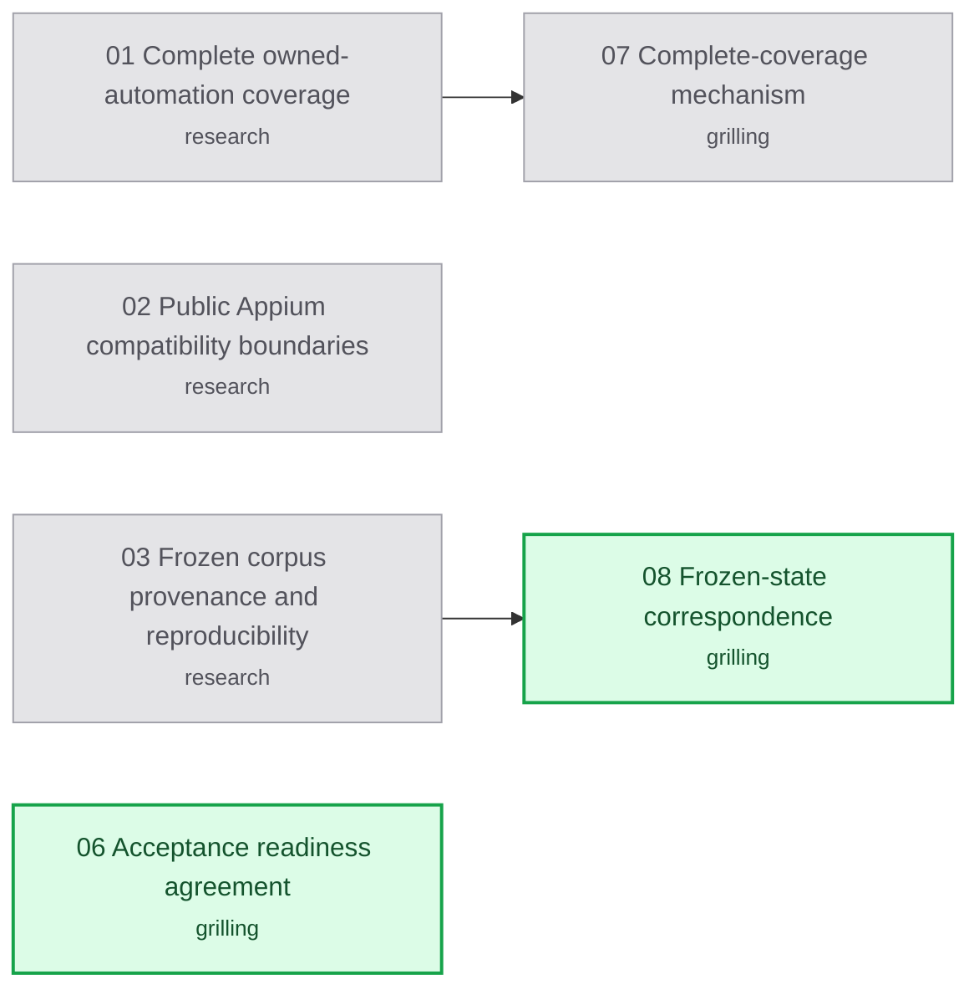

# Appium migration handoff map

Labels: wayfinder:map
Status: charted

## Destination

Produce a short master handoff and detailed specifications for the remaining
Appium replacement phases: feasibility, ownership, adapter compatibility,
and acceptance/cutover. Make unresolved decisions visible before coding.

## Notes

Read [the roadmap](roadmap.md) first and [the master handoff](handoff.md) next.
Use the [published spec](spec.md) for accepted requirements and the phase files
for implementation acceptance detail. The owner selected this packaging on
2026-10-14. Preserve the published spec, confirmed plan, and historical receipts.

Use `wayfinder` for decision work; `grilling` and `domain-modeling` for human
choices; `research` for primary-source investigations; `writing-for-agents`
then `unslop` for handoff text. Use the existing glossary's admission, lease,
fence, run, snapshot, and observed-outcome terms. Record new meanings only
through an actual discussion, not by silently changing the glossary.

This map is planning-only. Code implementation, device experiments, migrations,
Jev calls, and release actions remain paused. A decision ticket resolves a
question, not a slice of the Appium build. Charting closes no human ticket.
Research agents work on isolated `research/` branches and return sourced notes.

For a later session, take the first open, unblocked, unclaimed child ticket,
claim it before work, and resolve at most one non-research ticket. Read the
linked phase only when its work is in scope. Resolve design questions before
calling the affected phase implementation-ready; phase execution still needs
its recorded entry gate and an owner resume instruction.

## Decisions so far

- [Complete owned-automation coverage](issues/01-complete-automation-coverage.md): final scans need prior completeness evidence; method selection remains open.
- [Public Appium compatibility boundaries](issues/02-public-appium-compatibility.md): bounded extension operations and legacy selection preservation are required.
- [Frozen corpus provenance and reproducibility](issues/03-frozen-corpus-provenance.md): recoverable archives still need production Appium state correspondence.

Only research tickets resolved during charting. Human tickets remain open;
recorded owner profile input is preserved in its named ticket.

## Route

<!-- route:start -->

<!-- route:end -->

## Not yet specified

- Exact operation payloads and result fixtures for preserved behavior not yet
  exercised by the tracer; refine after public-capability research.
- Operation-specific ownership evidence fields not fixed by the complete-coverage
  method and authoritative state discussions; refine after those decisions.
- Exact Appium captures for historical screen states; specify collection details
  after frozen-state correspondence is agreed. Reconciliation is now its own ticket.

## Out of scope

- Phase 2 decisions moved on 2026-10-19 to the [Appium Phase 2 decision map](../appium-phase2/map.md): [Named-profile selection contract](issues/04-profile-selection-contract.md) and [Evidenced release with immutable outcomes](issues/05-evidenced-release-state.md) continue there.

Allocation reclamation, physical-iPhone enablement, native measurements,
remote/shared Appium servers, backend fallback, and publishing a release.
Keep them in their later roadmap scopes. Existing bounded allocation
preparation and physical-Android acceptance remain inside this migration.
