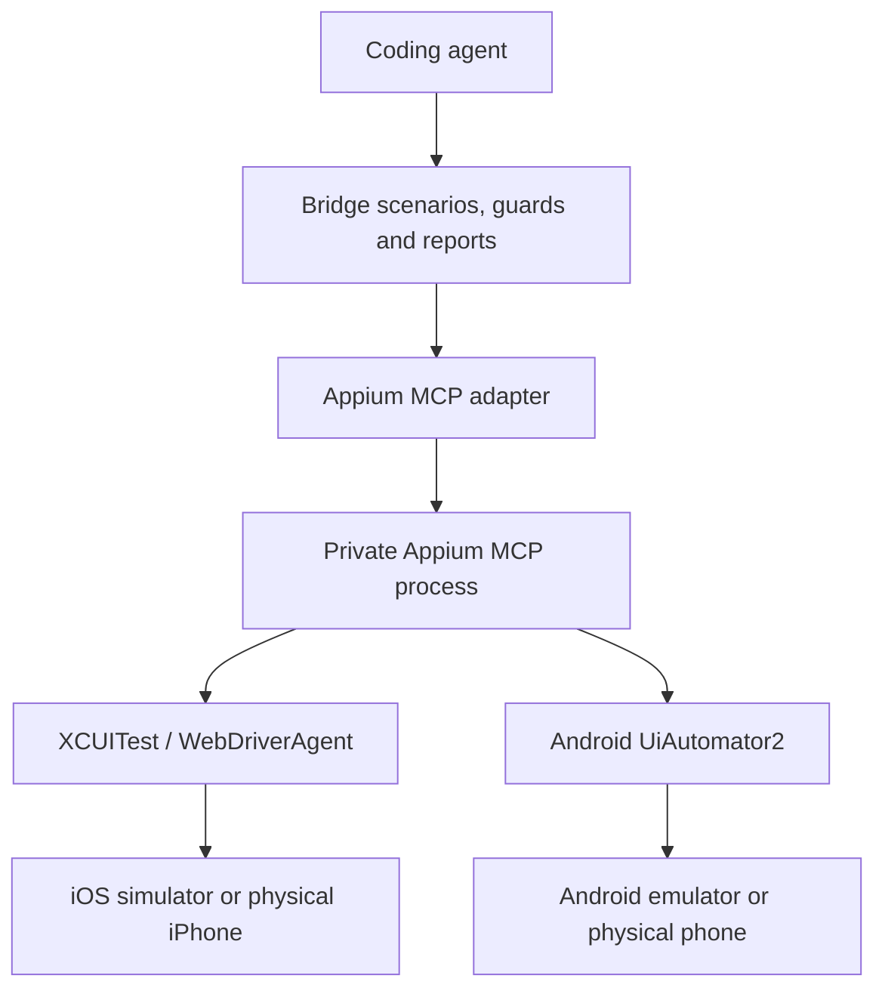

# Migrate jev-ios-bridge to Appium MCP

Replace the existing iOS and Android device backends with Appium MCP. Keep the bridge responsible for scenarios, guards, device ownership, recovery, evidence, and verdicts, with Jev judging assertions.

The owner selected Appium MCP as the sole device backend. This supersedes the earlier optional-backend proposal: the target architecture has no backend selector, MobileBuildMCP execution path, or mobilecli device-agent execution path. The owner confirmed the complete revised plan on 2026-10-12 and explicitly instructed: "confirm but not implement yet". Plan approval does not authorize implementation.

The [replacement-release specification](spec.md) was published to the local tracker on 2026-10-12 with `Status: ready-for-agent`. It synthesizes this confirmed plan; implementation remains unauthorized.

The engineering goal is to let a coding agent inspect, exercise, verify, and eventually measure iOS and Android apps on simulators, emulators, and physical devices. Deliver UI verification first; add native performance measurement as a separate milestone.

## Starting point

The technical review examined release `v1.4.0`, commit `0d3e54a9d1d80c1a9188c8c5e5717254e9a95994`. Its host check completed with 2,253 of 2,258 tests passing; typechecking and a separately run build passed. Four failures involved stale `1.3.1` expectations; the fifth involved a packaged README link to omitted release notes. These are historical results from the review, not a fresh check of this checkout.

**Selected implementation base (owner, 2026-10-12):** release `v1.4.0`, source commit `0d3e54a9d1d80c1a9188c8c5e5717254e9a95994`. Commit bounded baseline repairs separately before adapter work. Preserve the original checkout's local edits in place.

The original checkout is on `main` at `86d81bf573a0a8effe9f8d7509cc002f3f3dd187`, declaring `1.3.1`, and is an ancestor 172 commits behind the selected base. Upstream `main` at `dadd63a6525f470dc199e4c177308bb35753bdba` adds only a marketplace pointer to the v1.4.0 artifact; it still declares `1.3.1` and lacks the v1.4.0 source. Reconcile that branch difference before eventual integration; neither old source branch is the migration base.

The review inspected Appium MCP `1.95.8`. The 2026-10-12 source check also found published `1.97.0`, commit `ddbfdc7a133828ecd4e4e17e680a1bb904a166cb`. These are compatibility candidates, not tested selections. Phase 1 records the exact package and resolved stack it proves.

## Preservation and release scope

Preserve these selected-base capabilities before removing the old production backends:

- Version-1 scripted scenarios, launch options, guards, selectors, environment values, Jev policy, verdicts, CLI/MCP contracts, and report/evidence layout.
- Experimental driven scenarios, preflight/local-only policy, hand-backs, `resolve_step`, fresh-screen checks, and existing supported gestures and attach behavior.
- Experimental observed actions: immutable identities and outcomes, identical-request retrieval, conflict refusal, one executor, durable cancellation and quarantine, prepared-allocation hand-off, inventory/provisioning, capacity retention, and offline migration. An observed outcome remains distinct from a scenario verdict.
- Ownership history, migration receipts, reservations, unresolved native-owner exclusions, and quarantined operations. The disappearance of an old process or receipt does not establish settlement.
- Android `capture`, live app logs and `logs`, app health attribution, shown values, watch/screenshots, screenshot coordinates, and simulator presentation settings.

Native studies under `spikes/native-owner/` remain research, outside the production mode inventory. Preserve their evidence and unresolved ownership constraints. New native performance measurement remains later work.

**Replacement release gate (owner, 2026-10-12):** require compatibility and live acceptance on iOS simulators, Android emulators, and physical Android devices. Existing documentation describes physical Android support as untested; establish fresh evidence rather than carrying that assumption forward. Physical-iPhone support follows as a separately gated capability, after signing, recovery, and live acceptance pass. Publish only the device categories with completed evidence.

## Intended architecture

Keep the host agent connected to the bridge's existing interface. The bridge calls Appium MCP internally through a narrow adapter implementing the device-driver contract. Start with a private local stdio process and an explicitly identified, bridge-owned Appium session per run. Remote Appium servers, shared sessions, and device farms are later work.

Use existing, prepared devices for the Phase 1 tracer. Preserve v1.4.0's supplied-inventory and bounded fresh-simulator allocation for observed actions, which retain their iOS-simulator-only, single-authored-tap scope during this migration (owner, 2026-10-12). Document device prerequisites and later iPhone signing. Appium session ownership does not imply ownership of the phone or permission to erase it.

**Native-helper boundary (owner, 2026-10-12):** Appium MCP is the sole UI observation and input layer. Prefer public Appium/core capabilities wherever parity is proven. Permit bounded native helpers for live app logs and crash detection, evidenced fencing of owned automation, simulator presentation, and existing fresh-simulator allocation. Keep them behind explicit ownership, operation deadlines, and the driver lifecycle; they are not alternate UI backends.

Log and health observers are read-only. Fencing stops only recorded owned automation. Fresh creation retains ADR-0009's explicit device type/runtime, durable intent and host guard, capacity reservation, and uncertainty rules; unknown creation is never retried automatically. Preserve ADR-0007's optional, nonfatal simulator presentation. Retire its AXe tap path at cutover. Normal cleanup does not erase phones or delete allocated simulators; allocation reclamation is a later, separately validated lifecycle.

## Delivery phases

| Phase | Priority | Status | Work | Completion criterion |
|---|---|---|---|---|
| 0. Baseline | P0 | Not started | Start from the selected v1.4.0 commit, reconcile release history, reproduce the five review failures, and make bounded release fixes. | A documented baseline and passing relevant release checks. |
| 1. Protocol feasibility | P0 | Not started | Freeze the resolved Appium stack; prove result parsing, lost-session reconciliation, cancellation, and cleanup under the agreed lease-release predicate. | An explicit go/no-go report with fixtures and live evidence; every feasibility condition below passes before full adapter work. |
| 2. Configuration and ownership | P1 | Not started | Add device profiles, replace backend-specific preflight, and establish ownership and recovery for the replacement-release device categories. | Invalid configuration fails before mutation; competing bridge runs cannot operate the same device. |
| 3. Device adapter and mode compatibility | P1 | Not started | Normalize observations, cover the complete driver behavior, and validate scripted, driven, observed-action, and capture paths. | Every preserved mode has success, failure, cancellation, and recovery evidence within its existing platform scope. |
| 4. Live acceptance and cutover | P1 | Not started | Pass both assertion-corpus gates and live parity on the three replacement-release device categories; then remove old execution paths and dependencies. | Published capability matrix, passing judgment and live evidence, and Appium-only production routing. |
| 5. Allocation reclamation | P2 | Not started | Add verified resource cleanup while retaining immutable observed-action history. | Repeated reclamation releases capacity only after verified cleanup. |
| 6. Physical iPhone | P2 | Not started | Prove signing, full driver behavior, ownership, and recovery on physical iPhones. | Physical-iPhone capability matrix and live evidence pass before support is advertised. |
| 7. Performance measurement | P2 | Not started | Add native benchmark/profiling runners and structured measurement artifacts. | Repeatable device-specific measurements with comparable baselines. |

Phases 0 and 1 precede production integration. Ownership controls precede actions. Live acceptance precedes removal of the old implementation from the release. The old code may remain temporarily as a development reference, but it is not a fallback in the target product.

## Phase 1 feasibility gate

Approve full adapter work only after a report establishes:

1. Required tool schemas and every consumed result are validated against the pinned stack, including creation IDs, XML envelopes, all matching elements, screenshots, errors, and malformed results.
2. Lost session-creation and action responses can be reconciled or durably quarantined without redispatching mutations. An empty process-local session list does not establish that creation never happened.
3. Cancellation stops new dispatch, preserves outstanding-operation uncertainty, and cleans up only owned work. Late replies cannot resume actions or change a committed outcome.
4. The lease-release predicate below is demonstrated on both an iOS simulator and an Android emulator, covering normal cleanup, cancellation, lost replies, and process failure. A successful session-deletion reply alone is not assumed to be a native fence.

These are the owner-agreed Phase 1 gates (2026-10-12). A failing item stops production integration and returns the design for review. Lost or unreachable devices retain quarantine while evidence is incomplete; they do not qualify for automatic release.

## Quick fixes: establish a trustworthy baseline

Reproduce the review's five failures on the selected base. Correct version expectations using the package version while retaining an independent release/tag consistency check. Repair the packaged README link by shipping the referenced document or using a valid release URL. Verify the built tarball's contents and links.

Keep these repairs separate from backend migration. Re-run the release checks on the resulting artifact. A passing host suite does not replace live device acceptance.

## Protocol and adapter contract

Use the current `DeviceDriver` interface as the starting seam. The inspected integration points are `src/device/factory.ts`, `src/contracts/index.ts`, `src/cli.ts`, and the existing scenario execution/reporting modules. Confirm them against the chosen base before editing.

| Operation | Required behavior |
|---|---|
| Prepare | Resolve a canonical device identity, acquire ownership, create an owned Appium session, and honor supported launch options. |
| Observe | Parse platform accessibility XML into Jev roles, identifiers, labels, values, visibility, frames, and snapshot-scoped references. Save screenshots as evidence. |
| Act | Resolve one target, reject ambiguity and stale references, and dispatch the requested action once. Preserve replacement-text semantics. |
| Close | Stop new dispatch, preserve existing app-shutdown behavior, settle outstanding work, delete the owned session, and release ownership only when cleanup is confirmed. |
| Live app logs | Preserve app output in the pane, headless `logs`, and step tails; mask supplied values, distinguish unavailable logs from empty logs, and stop only owned streams. |
| App health | Preserve `APP_EXITED` and `APP_NOT_RESPONDING` attribution, bounded handling of late events, and unknown status when detection is unavailable. Expected bridge shutdown is not an app crash. |
| Shown values | Read the displayed field value after replacement; a typing acknowledgment or echoed input is not shown-value evidence. Preserve Android `typedFields` reporting without treating a legitimate display transformation as action failure. |
| Gestures and coordinates | Preserve driven back/scroll paths and existing Android `tapAt`; use the paused screenshot's dimensions, refresh before dispatch, and reject stale or unknown geometry. Existing iOS `tapAt` and attach refusals stay explicit until separately enabled. |
| Metadata and metrics | Preserve canonical identity, preparation warnings, and truthful reference-refresh metrics. Replace backend-specific provenance with the frozen stack; do not reuse MobileBuildMCP's tap-alias proof for Appium. |

The internal TypeScript interface is not frozen by ADR-0005. Acceptance covers the user-visible behavior supplied by it, including these optional methods and action-result fields.

Preserve Android `capture` as a separate, key-free path: settle and print the current screen under ownership without restarting or stopping the app and without taking a screenshot. Its `--jev` output must use the production Android observation path. The cutover audit includes this path, both public entry points, and the separate preparation/observed-driver factories in the selected base.

Appium MCP's inspected implementation returns some essential values inside human-readable text: session creation, page-source envelopes, element IDs, and screenshot paths. Treat this as a compatibility risk. Prefer upstream structured results and validate every required result against pinned fixtures. The owner permits a small, versioned bridge-owned extension through the public `appium-mcp/core` interface when required IDs, results, or session inventory cannot otherwise be exposed reliably (2026-10-12). Keep private imports and an upstream fork outside this design. The extension must pass the same feasibility gate; a structured cleanup acknowledgment is not native fencing evidence.

Keep XML normalization and locator handling independent of Jev judgment. Preserve Jev's unique-target requirement; an Appium lookup that returns the first match is insufficient. Validate refresh and rematching before dispatch, distinguish platform-specific swipe/back behavior, and bound screen-settling waits. A completed automation command is execution evidence, not proof of the intended app outcome.

Disable Appium's optional AI features. Pass every session-scoped operation an explicit session ID. Validate the server version and required tool schemas before creating a session. Never silently switch transports or retry a mutation after an uncertain response.

Freeze and record the resolved Appium MCP, Appium/base-driver, XCUITest, UiAutomator2, and WebDriverAgent dependency graph with integrity metadata. Verify the versions actually loaded at runtime. Freeze WDA runtime artifacts separately by version, architecture, hash, and relevant signing provenance: upstream simulator preparation can select `releases/latest` or the newest cache independently of npm resolution. A wrapper pin alone does not satisfy this requirement. Phase 1 selects the tested stack; inspected upstream versions are candidates only.

## Configuration and compatibility

Define one validated project configuration for named device profiles, app/device identity, platform capabilities, iPhone signing references, and startup/operation/cleanup timeouts. There is no backend-selection setting. Keep secrets outside tracked configuration and pass only required environment variables to the Appium process.

Update both CLI and MCP composition. The current CLI selects a device using the existing backend before it creates the driver; replacing only the factory would retain simulator-only assumptions. Validate physical-iPhone identifiers explicitly instead of assuming every iOS identifier is a simulator UUID.

Preserve valid existing scenario and report contracts. Reject profile/scenario conflicts before device mutation. Prove existing launch arguments, Android intent extras, attach behavior, and supported gestures instead of downgrading them to unsupported capabilities. New combinations may remain unavailable pending evidence. Any invalidation of a valid existing script or change to frozen semantics needs the repository's major-version process.

Preserve snapshot and screenshot metadata, including dimensions for coordinate conversion. Appium action timing is automation timing; it must not be labeled app performance. Add backend/version provenance without exposing credentials or raw typed values. Appium text-entry responses can echo the supplied text, so filter responses and errors before they reach run logs.

## Ownership, recovery, and allocation reclamation

Extend v1.4.0's existing per-user SQLite admission authority to Android through an explicit offline migration (owner, 2026-10-12). Its schema currently admits only iOS simulators; validate canonical platform/device identities rather than extending UUID assumptions to Android. Preserve history, quarantines, exclusions, reservations, and receipts, and fail closed on incomplete migration. Use the same authority for all updated entry points; do not introduce an Appium-specific ownership store. Later physical-iPhone support extends the same authority. Admission remains distinct from the device lease and does not certify native release. As ADR-0008 states, old binaries and external device tools require operational exclusivity.

**Lease-release predicate (owner, 2026-10-12):** release a device only when all three are durably evidenced:

1. Dispatch authority is closed, so no new or late command can be issued for the run.
2. Every issued command is terminal, or covered by a proven fence that prevents it from taking further effect.
3. Every owned native automation component that could still act is verified stopped or unable to accept further commands.

Record the owned session/process/component identities, outstanding-command disposition, fence evidence, and cleanup result before release. Session-delete success, an empty session list, and MCP process exit alone are insufficient. Lost creation without a session ID remains quarantined until the same predicate can be established. Safe cleanup never changes an uncertain action into a confirmed one; its outcome stays inconclusive. Phase 1 must demonstrate the platform mechanisms that establish this predicate.

- Serialize commands for one device. Resolve Android emulator aliases and serials to the same stable identity.
- Preserve quarantine and action history when migrating old state. Removing a backend does not erase an uncertain operation it issued.
- On cancellation, stop new dispatch immediately. An already-dispatched action remains pending until its outcome is known or recorded as uncertain.
- On a lost action response, report an inconclusive outcome. Do not repeat the tap or text entry automatically.
- If session creation loses its response, retain uncertainty even when no session ID reached Jev.
- Verify cleanup before releasing ownership. An MCP disconnect or process exit alone does not certify that native work has stopped.
- Provide diagnosis and explicit recovery for abandoned ownership. Dead processes, missing responses, and unreachable devices need distinct evidence.

Keep session cleanup separate from device allocation cleanup. The first Appium milestone uses existing devices; it must not delete simulators or erase physical phones during normal cleanup.

For v1.4.0 allocations, preserve immutable action records and tombstones while introducing a separate resource-cleanup lifecycle: claim cleanup durably, perform device work outside the transaction, verify completion, then release capacity. Start with allocations the bridge can prove it owns and whose work has settled. Unknown creation or cleanup remains quarantined until reconciliation provides evidence. Avoid pooling and automatic retention policies until repeated reclamation succeeds.

## Test and live acceptance plan

Write contract tests for the pinned MCP responses, invalid payloads, schema changes, XML normalization, ambiguous selectors, stale references, and error mapping. Test through the adapter interface with recorded fixtures and a controllable MCP test process. Retain report and scenario compatibility checks.

Exercise cancellation, late replies, process failure, lost session creation, cleanup failure, and competing ownership. Verify that these paths neither redispatch mutations nor release uncertain devices.

Appium XML changes the evidence source even if the final renderer stays unchanged. Apply [the stability policy](../../docs/guide/11-stability.md#pinned-dependencies), ADR-0004, and ADR-0006 explicitly before cutover:

- iOS: the frozen 24 screens and 48 claims, zero confidently wrong answers, at most three uncertain claims.
- Android: the frozen 10 screens and 31 claims, zero confidently wrong answers.
- Keep the pinned production judge, fixed 0.9/0.1 bounds, and one judgment per screen with no re-asking. Preserve frozen claims, truth labels, and denominators.

**Corpus protocol (owner, 2026-10-12):** obtain matching Appium XML and screenshots for the frozen screen states. Feed XML through the production Appium normalizer and production observation renderer, then the pinned production Jev judge. Record source captures, screen-state correspondence, exact observation/request text and hashes, frozen claim identities/truths, and stack provenance. Preregister the protocol before querying Jev.

Existing runners use archived snapshots or the old Android prototype mapping; rerunning them unchanged does not exercise Appium XML. Recover the Android corpus from repository history with provenance, including the placeholder correction at commit `2366759`; it is absent from the selected release tree. Unreproducible or changed historical states block evaluation until reconciliation is explicitly agreed. Preserve denominators and historical evidence instead of silently relabeling or dropping cases.

Run these acceptance categories on an iOS simulator, an Android emulator, and a physical Android phone for the replacement release. Apply them to physical iPhones before the later capability is enabled:

1. Launch, capture, tap, replace text, swipe, and complete a checkpoint.
2. Duplicate selectors, stale elements, keyboard state, and changing screens.
3. Cancellation during an action, Appium termination, and device disconnection.
4. Cleanup followed by at least 20 independent scenario/session cycles without accumulating owned sessions.
5. Competing updated bridge runs on the same device, including scripted/observed cross-entry-point exclusion. State the operational exclusion of old binaries and external tools; do not claim their automatic coordination.
6. Reports that distinguish app failure, automation failure, unsupported capability, and uncertainty.
7. App prints and platform log output reach the pane and headless `logs`, supplied values are masked, and stream failure remains distinguishable from an empty log. Each baseline-supported crash/ANR detector attributes a deliberate failure correctly and ignores expected shutdown; lost detection remains unknown.
8. Text replacement records a fresh shown value, including a legitimate display transformation; Android `typedFields` remains compatible. Android `capture` leaves app state and its key-free/no-screenshot behavior intact.
9. Driven hand-backs refresh the screen before dispatch. Existing Android coordinate taps scale from the paused screenshot, and stale, rotated, out-of-bounds, or unknown geometry dispatches nothing. Verify conversion on at least two device sizes. Keep currently unsupported iOS coordinate/attach combinations explicit.

Record device model, OS/toolchain versions, package versions, app build, commands, results, and artifact paths. Mark unavailable hardware as untested. Simulator success does not establish physical-device support.

Preserve the original v1.4.0 live simulator acceptance cases as outstanding evidence until executed or explicitly replaced by mapped acceptance cases. Before enabling allocation reclamation, demonstrate at least 20 allocation/action/cleanup cycles under the configured eight-allocation capacity limit.

## Cutover and later capabilities

After live parity, remove the old MobileBuildMCP and mobilecli execution paths, runtime dependencies, AXe tap path, backend-specific settings, and plugin/setup references. Retain migration readers needed to preserve existing ownership records and only the native helpers within the agreed boundary. Audit Android `capture`, observed-action preparation, every driver factory, and direct native-command exceptions so old UI automation does not remain hidden behind another entry point. Apply [ADR-0010](../../docs/adr/0010-appium-mcp-as-the-shared-device-layer.md) and [ADR-0011](../../docs/adr/0011-shared-admission-and-evidenced-native-fencing.md); update supersession notes in ADR-0002/0006 and the retired AXe portion of ADR-0007 when cutover actually completes. ADR-0009's bounded creation constraints survive.

The feasibility tracer can start with scripted interactions. The replacement release preserves the selected-base modes: driven scenarios and observed-action allocations need their own capability and recovery validation before cutover. Allocation reclamation and native measurements may follow later.

Add performance measurement through separate native runners:

| Measurement | iOS | Android |
|---|---|---|
| Launch | XCTest launch metrics | Macrobenchmark startup metrics |
| Frame behavior | XCTest hitch/signpost metrics and Instruments | Macrobenchmark frame timing and Perfetto |
| CPU and memory | XCTest metrics and Instruments | Perfetto and Android profiling tools |
| Energy | Instruments Power Profiler where supported | Power metrics/system traces where supported |

Let the agent select a benchmark, then execute a repeatable native measurement loop. Store raw traces and structured results with device/build provenance and a comparable baseline. Use physical devices for representative performance results; mark unavailable measurements explicitly. Hardware and OS support vary, particularly for energy measurements.

## Dependencies and success criteria

Shared understanding of this plan is confirmed, and all eight interview decisions are settled. Separate owner authorization to begin implementation remains required; it has not been given. Required for live acceptance: macOS/Xcode, Android SDK and compatible Java tooling, the frozen Appium stack, prepared test apps, device access, and Jev credentials for assertion checkpoints. Physical-iPhone enablement also requires signing.

Deliver separate reviewable changes for baseline fixes, protocol/configuration, ownership and adapter integration, mode compatibility, and live acceptance/cutover. Follow with allocation reclamation, physical-iPhone enablement, and native measurements.

- [ ] Existing production device backends are absent from the target execution architecture.
- [ ] Both public entry points route device work through the Appium adapter.
- [ ] Scenarios, guards, judgments, reports, and evidence retain documented semantics.
- [ ] Uncertain actions cannot be silently repeated or treated as completed.
- [ ] Cleanup and recovery preserve ownership until supported by evidence.
- [ ] Every advertised device category has live acceptance evidence.
- [ ] Allocation cleanup preserves historical action records and releases verified capacity.
- [ ] Native measurements remain separate from automation duration.
- [ ] Release checks pass and documentation states tested limits.

## References

- [Reviewed v1.4.0 release](https://github.com/hugues-vnsgn/jev-ios-bridge/releases/tag/v1.4.0)
- [Upstream marketplace-only main commit](https://github.com/hugues-vnsgn/jev-ios-bridge/commit/dadd63a6525f470dc199e4c177308bb35753bdba)
- [Appium MCP source, tools, and public extension interface](https://github.com/appium/appium-mcp)
- [Inspected Appium MCP dependency ranges](https://github.com/appium/appium-mcp/blob/ddbfdc7a133828ecd4e4e17e680a1bb904a166cb/package.json)
- [Inspected simulator WDA artifact selection](https://github.com/appium/appium-mcp/blob/ddbfdc7a133828ecd4e4e17e680a1bb904a166cb/src/tools/ios/prepare-ios-simulator.ts)
- [Inspected session deletion and local registry](https://github.com/appium/appium-mcp/blob/ddbfdc7a133828ecd4e4e17e680a1bb904a166cb/src/session-store.ts)
- [Inspected MCP tool registry](https://github.com/appium/appium-mcp/blob/ddbfdc7a133828ecd4e4e17e680a1bb904a166cb/src/tools/index.ts)
- [Inspected public-core driver access](https://github.com/appium/appium-mcp/blob/ddbfdc7a133828ecd4e4e17e680a1bb904a166cb/src/plugin.ts)
- [Official Appium tools](https://appium.io/docs/en/latest/ecosystem/tools/)
- [Apple performance tests](https://developer.apple.com/documentation/xctest/performance-tests)
- [Android Macrobenchmark](https://developer.android.com/topic/performance/benchmarking/macrobenchmark-overview)

The design interview is complete. Begin implementation only after a separate owner instruction. Implementation remains not started; tested stack versions and actual native fencing mechanisms must be established by Phase 1, not assumed from this design approval.
