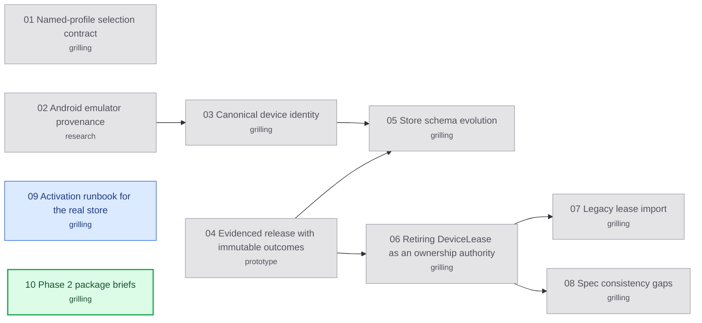

# Appium Phase 2 decision map

Labels: wayfinder:map
Status: charted

## Destination

Phase 2 is implementation-ready: every open decision for profiles, the single
admission authority and recovery is locked in
[the Phase 2 specification](../appium-mcp-migration/phases/phase-2-ownership.md),
with one bounded brief per package (2A–2D) for the implementer.

## Notes

Planning only; building starts after this map closes, under the package briefs
(as Phase 1 finished: owner decisions first, then capped briefs with stop rules).
Phase 1 GO is the entry evidence ([PR #53](https://github.com/hugues-vnsgn/jev-ios-bridge/pull/53)).
The owner wants a solid, extensible foundation: one ownership authority for every
entry point and platform, a store that can evolve, and later device categories
reserved but refused. Keep sessions token-efficient.

Use `grilling` + `domain-modeling` for HITL tickets, `research` for AFK tickets,
`prototype` for the release-state model. Use `GLOSSARY.md` terms (admission,
device lease, run, attempt, observed outcome, quarantine); change meanings only
through discussion. Read real code from `origin/main` or this branch, never the
stale main checkout. Owner decisions from the Phase 2 charting session
(2026-10-19): destination = implementation-ready; `DeviceLease` stops being an
ownership authority; later device categories are reserved, not enabled;
real-store migration needs a separate owner go-ahead.

## Decisions so far

- [Android emulator provenance](issues/02-emulator-provenance.md): key emulators on the console's `realpath(avd path)` plus category; exact-reply parsing; emulator 30+ with auth token; refuse on conflicts.
- [Named-profile selection contract](issues/01-profile-selection-contract.md): versioned `.jev/profiles.json`, `--profile`/MCP `profile`, explicit > default > legacy order, scenario-only conflicts, budgets only tighten, binding recorded.
- [Canonical device identity](issues/03-canonical-device-identity.md): identity = (category, value); simulator UDID, emulator `realpath(avd path)`, phone `ro.serialno`; `ios-phone` reserved; iOS rows and allocation IDs unchanged; live resolution, conflicts refuse.
- [Evidenced release with immutable outcomes](issues/04-evidenced-release-state.md): authority-verified fence receipts free the lease; outcomes, capacity and append-only quarantines stay; historical, exclusion and unknown-creation quarantines not liftable in Phase 2; late replies are evidence only.
- [Store schema evolution](issues/05-store-schema-evolution.md): explicit offline forward-only upgrades, exact version match, tool-taken backup, append-only receipts, checked recover, (category, value) key, immutability triggers, no downgrade (ADR-0012).
- [Retiring DeviceLease as an ownership authority](issues/06-device-lease-retirement.md): admission is the only owner record; lock file kept as an old-binary marker; every command recorded; dead owners recovered at admission by generation-bound sweep; adb stop evidence; class renamed.
- [Legacy lease import](issues/07-legacy-lease-import.md): repeatable offline import after the upgrade; every leftover legacy lease becomes a historical quarantine (UUID exact, others name-matched); live PID refuses; imported files count as known markers.
- [Spec consistency gaps](issues/08-spec-consistency-gaps.md): ten cross-section gaps closed in one batch: recovery claim, settled MobileBuildMCP evidence, upgrade recovery event, fresh-store mode, `observed` outcome, budget fields, multi-transport ambiguity, release refusal order, identity refusal reasons, reused PIDs.

## Route

<!-- route:start -->

<!-- route:end -->

## Not yet specified

Nothing left: the last two patches graduated into Activation runbook for the real store and Phase 2 package briefs.

## Out of scope

Applying the migration to the real store (separate owner go-ahead), enabling
physical iPhones (Phase 6), physical Android acceptance (Phase 4), allocation
reclamation and lifting historical, exclusion or unknown-creation quarantines
(Phase 5 or separate owner maintenance), and the Appium adapter itself (Phase 3).
