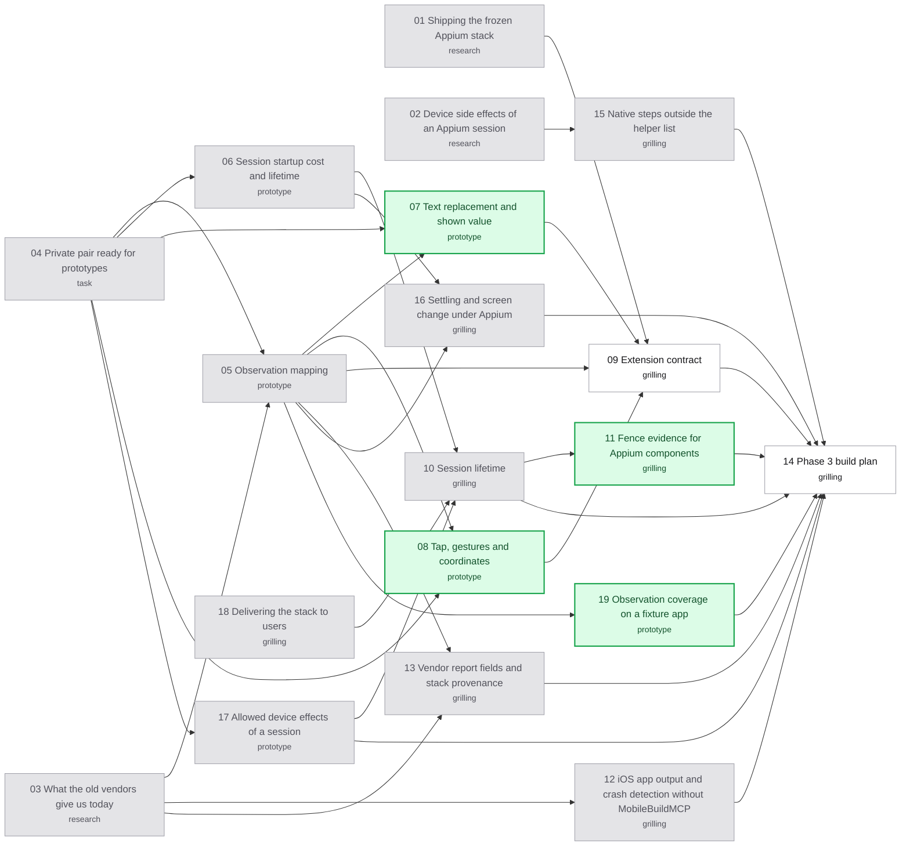

# Appium Phase 3 decision map

Labels: wayfinder:map
Status: charted

## Destination

Phase 3 is ready to build: every open decision for the Appium driver and the
preserved modes is locked in
[the Phase 3 specification](../appium-mcp-migration/phases/phase-3-adapter.md),
and a build plan (PR split, worker briefs, verification bar) lets the build
start without another decision.

## Notes

Planning only. Building starts after this map closes, under its build plan.
Entry evidence: Phase 1 GO ([result](../appium-mcp-migration/phase-1-result-20261018.md),
[freeze manifest](../appium-mcp-migration/evidence/phase1-freeze-20261018.json))
and Phase 2 complete on main `4465e93e9` ([exit note](../appium-phase2/phase-2-exit.md), PRs #56–#67).

Use `grilling` + `domain-modeling` for HITL tickets, `research` for reading-only
tickets, `prototype` where a run on the private pair can decide. Use
`GLOSSARY.md` terms (admission, device lease, fence, fence receipt, quarantine,
snapshot, element reference, shown value, run, observed outcome); change
meanings only through discussion. Read code from `origin/main` or this branch
(`feat/appium-phase3`), never the stale main checkout. Research reports go on
throwaway `research/<name>` branches under `.scratch/appium-phase3/research/`.
Each resolution writes its locked decision into the Phase 3 specification.

Owner decisions from the charting session (2026-10-22):

- The destination includes the build plan, written in the last ticket.
- Prototypes may run the Phase 1 private pair (private simulator set and private
  AVD home under the `feat/appium-mcp-migration` worktree) with the candidate
  stack's research scripts: one case at a time, no Jev calls, no writes to the
  real admission store, no other simulator, AVD or phone.
- The Phase 3 build is proven on the host against a controllable fake Appium
  MCP that replays real wire exchanges recorded on the private pair. Every live
  claim (coordinates on two sizes, logs and crashes, the 20 cycles, the phone)
  is Phase 4. Real-store activation stays a separate owner action and Phase 3
  does not need it.
- Phase 3 PRs merge to main. The last Phase 3 PR switches CLI, MCP, capture and
  observed composition to Appium; old backend code stays unused until Phase 4
  removes it. No release before Phase 4 passes; an urgent 1.4.x fix branches
  from the `v1.4.0` tag.
- The PLAN-B bar governs the build (CI incl. packaging proof, no open P0/P1
  after two fix rounds, owner's yes). The Codex worker builds on GPT-6.1-Sol
  only. The owner merges each PR. This planning lands as one planning PR.

Carried from Phase 2 (`~/.codex/reports/jev-ios-bridge/phase2-build/FOLLOW-UPS.md`),
sorted by the owner on 2026-10-22; the build plan schedules them:

- One small "Phase 2 leftovers" PR at the start: the imported legacy marker
  refusing `DEVICE_BUSY` instead of its historical quarantine; a wireless phone
  turning unready mid-run reporting `NOT_CONNECTED`/`UNAUTHORIZED` instead of
  `DEVICE_IDENTITY_CONFLICT`; the odd-state phone wording "is offline";
  identity sub-reasons (`vendorCode`) in the human summary.
- Inside the Phase 3 PR that touches that code: branded identity types and the
  independently nullable recovery closure fields.
- Early, because Phase 3 leans on these suites: the load-sensitive 2 s `ps`
  bound in the descendant test, the public-core creation flake (tests 678/679),
  the integration-edge completion poll, the `test_study` child-fixture hang risk.

## Decisions so far

<!-- one line per resolved ticket: [title](issues/NN-slug.md): gist -->

- [Allowed device effects of a session](issues/17-allowed-device-effects.md): Android hidden-API keys, accessibility, instrumentation and forward allowed and undone by a clean delete; server APKs stay; the Settings helper is never installed; recovery restores everything after an unclean exit; iOS private HOME, never restarted; `skipLogCapture` always.
- [Session lifetime](issues/10-session-lifetime.md): one child and one session per command; driven pause keeps the session and refreshes on the answer; observed sessions end before park; `delete_all` plus fence receipts; the frozen preinstalled WDA.
- [Settling and screen change under Appium](issues/16-settling-and-screen-change.md): one bridge loop on both platforms (250 ms, 3 s, two matching hashes); a bridge hash without the status bar; iOS gains `settled:false`; one screenshot after settling, downscaled to a JPEG of at most 800 px.
- [Session startup cost and lifetime](issues/06-session-cost-and-lifetime.md): iOS session cold about 78 s and warm about 5.8 s; Android cold about 12.4 s and warm about 6.8 s (today about 2 s); idle up to 900 s survives and `newCommandTimeout` is inert; `delete_all` cleans up on EOF and on parent kill; a leftover Android forward blocks the next create; iOS native-launch attach works and print streaming goes to the fixture app.
- [Observation mapping](issues/05-observation-mapping.md): pinned settings (iOS exclude nothing; Android compression off, topmost app window, depth 70) applied after create and read back; today's meanings kept and three iOS gaps fixed; refuse incomplete on invalid XML, a driver error or the depth limit; the same-frame alias becomes a bridge rule pending its proof (19); bridge-issued snapshot-bound refs.
- [What the old vendors give us today](issues/03-what-the-old-vendors-give-us.md): MobileBuildMCP supplies all iOS observation, refs, input, settle, screenshot, launch and the app-exit signal; mobilecli only Android's agent; AXe is never called; 17 public surfaces carry vendor meaning.
- [Device side effects of an Appium session](issues/02-session-device-side-effects.md): sessions install packages and change global settings and Simulator preferences that today's drivers never touch; app-touching effects can be switched off for capture and attach; four Android effects cannot; appium-mcp ignores `settings[...]` capabilities.
- [Shipping the frozen Appium stack](issues/01-shipping-the-frozen-stack.md): the plugin installer refuses the stack's lock, so ship two release-built archives (stack and exact Phase 1 WDA runner) extracted on first use; private client `@modelcontextprotocol/sdk` 1.32.1; ten delivery choices go to the owner.
- [Private pair ready for prototypes](issues/04-private-pair-ready.md): frozen inputs unchanged; one Phase 1 normal case per platform passed 14/14 (iOS session ready 43 s, Android 54 s); keep the load-below-8 guard.
- [Vendor report fields and stack provenance](issues/13-vendor-report-fields-and-provenance.md): `vendorCode` holds the underlying code plus an additive `vendorSource`; an additive `prepared.stack` provenance block (Android `agentSha256` kept as the UiAutomator2 APK hash); all loaded MCP libraries recorded; iOS reference metrics omitted on Appium; four goldens change additively.
- [Delivering the stack to users](issues/18-delivering-the-stack-to-users.md): ship two release archives (unpruned stack, exact Phase 1 WDA) extracted offline into one shared per-account copy; Apple silicon only; claim iOS 26.5/Xcode 27.0 and warn outside it; Node 24+ with a Phase 4 live case; npm and plugin both supported; full notices file; owner-triggered re-freeze; client sdk 1.32.1 (ADR-0013).
- [iOS app output and crash detection without MobileBuildMCP](issues/12-ios-app-output-and-crash-detection.md): the bridge launches the iOS app natively with a console it owns (prints, `APP_EXITED` by PID) plus `log stream`; Appium never relaunches; attaching to that app is unproven and goes to prototype 06 (ADR-0014).
- [Native steps outside the helper list](issues/15-native-steps-outside-the-helper-list.md): iOS boot and install for observed preparation are native simctl helpers; Android restart moves to Appium `startActivity`; Android wake and read-only probes stay native, with `skipUnlock` and `DEVICE_LOCKED` kept (ADR-0014).

## Route

<!-- route:start -->

<!-- route:end -->

## Not yet specified

- **Fake MCP provider fidelity.** How recorded wire exchanges are captured,
  stored and re-recorded when the frozen stack changes, so host tests stay
  honest. Clears once the extension contract and stack shipping are settled.
- **Driven gesture details.** Largest-scrollable versus screen-middle action
  paths and iOS back may need their own decision if the gesture prototype
  shows a behavior change.
- **Glossary for the Appium era.** Device layer, element reference issuance and
  any new terms (private MCP child, extension) once the contracts settle.

## Out of scope

Live acceptance, both Jev corpora, physical-Android acceptance and removal of
the old backends (Phase 4); real-store activation (separate owner action);
physical iPhone (Phase 6); allocation reclamation (Phase 5); native
measurements (Phase 7); building Phase 3 itself (after this map closes).
From Phase 2's follow-ups, left alone by the owner: emulators older than 30
whose console rejects the token, more adb stop-match shapes (they quarantine
safely), H04.01 subtest slowness (by design), and the lane kit (P2.8 replaced
it with committed tests).
