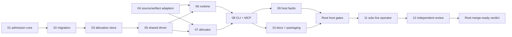

# Observed-action implementation handoff

## Overview

This handoff partitions implementation of the [accepted specification](spec.md). The specification is the normative index; its linked decisions own data shapes, lifecycle rules, defaults and limitations. This plan owns execution order and file ownership. [Rollout tickets](../observed-action-rollout/issues/) are executable briefs, separate from this effort's resolved planning questions.

Creating these briefs initially authorized planning only. The owner authorized rollout execution on 2026-10-08. Product edits, host checks, migration, simulator operation and integration start only on Root’s explicit rollout-ticket dispatch with the pinned base and satisfied dependencies. Publishing remains outside rollout scope. Full host/live acceptance rows remain UNVERIFIED until the required evidence is complete. The earlier experimental live results and 965-test check are baseline evidence, not acceptance of this implementation.

The final planning commit is pinned by the local immutable tag `plan/observed-action-rollout-2026-10-08`. At dispatch, Root resolves the pinned ref and supplies the full base SHA, ticket path, isolated worktree, branch and dependency integration SHAs. Agents verify them before editing. No ticket invents a future hash or branches from an unintegrated sibling.

## Dispatch and context

Read the ticket, this plan, [rollout spec pointer](../observed-action-rollout/spec.md), `AGENTS.md`, `docs/agents/issue-tracker.md`, `docs/agents/triage-labels.md` and `docs/agents/domain.md`. Read only the decision sections linked by the ticket after that common context. Consult `CONTEXT.md` and ADR-0002/0005/0007 for vocabulary and compatibility. The accepted creation decision deliberately requires Root's ADR amendment; an old ADR must not silently override the accepted specification or license broader commands.

Use ticket skills from the available catalog: `cook`, `tdd`, `codebase-design`, `diagnosing-bugs`, `do-test`, `writing-for-agents`, `unslop`, `project-organization`, `use-git-worktree`, `orca-cli` and `code-review` as assigned. Apply `implementing-an-issue` only when Root sends its explicit implementer brief. Approved models are `gpt-6-astra` high for admission/migration and independent safety review; `gpt-6.1-sol` high for implementation/integration; `gpt-6.1-sol` medium for routine tests/docs. The live pane stays `gpt-6-luna` high.

Each worker is one named role in one isolated worktree and owns its ticket's exact write set, including its own issue's Status/Comments. All other files are protected unless Root grants a documented ownership transfer. Common protected files are this plan, the planning map/tickets/evidence/spec, other rollout tickets, `AGENTS.md`, `CONTEXT.md`, `GLOSSARY.md`, `docs/adr/**`, release/version metadata, existing golden files, secrets, target-app sources and all existing device claims. Root alone updates shared decisions, dependencies and integration, and approves golden scope and existing-fixture changes. Ticket 08's adapter owner authors the declared new `tests/golden/observed-*.json` fixtures. Host tests use isolated durable stores and fake backends; real backend construction must reject test-store configuration.

## Phases and dependency graph

Current execution: waves A through D and the bounded ticket03 capacity-read repair are integrated and independently reviewed. Wave E is ready for dispatch; waves F through I await their dependencies. [Execution ledger](../observed-action-rollout/progress.md) records current commits and evidence; the table below defines prerequisites.

| Wave | Tickets | Integration prerequisite |
| --- | --- | --- |
| A | [01 admission core](../observed-action-rollout/issues/01-admission-core.md), [04 source/artifact adapters](../observed-action-rollout/issues/04-source-artifact-adapters.md) | Final pinned planning base |
| B | [02 offline migration](../observed-action-rollout/issues/02-offline-migration.md) | Root integrates 01 |
| C | [03 allocation store](../observed-action-rollout/issues/03-allocation-store.md) | Root integrates 02 |
| D | [05 shared driver](../observed-action-rollout/issues/05-shared-driver-fencing.md) | Root integrates 03 |
| E | [06 observed runtime](../observed-action-rollout/issues/06-observed-runtime.md), [07 allocator](../observed-action-rollout/issues/07-allocation-orchestration.md) | Root integrates 03, 04, 05 |
| F | [08 public adapters](../observed-action-rollout/issues/08-public-adapters.md) | Root integrates 06 and 07 |
| G | [09 host fault suite](../observed-action-rollout/issues/09-host-fault-suite.md), [10 docs/packaging](../observed-action-rollout/issues/10-docs-packaging.md) | Root integrates 08 |
| H | [11 serial live acceptance](../observed-action-rollout/issues/11-live-acceptance.md) | Root host gates PASS and live prerequisites |
| I | [12 independent review and merge readiness](../observed-action-rollout/issues/12-independent-review.md) | 11 evidence complete; Root retains final verdict |

Three child agents maximum at once. Empty slots do not justify bypassing dependencies. Root integrates commits in dependency order and publishes the resulting integration SHA before the next dispatch. Lifecycle and allocation may run concurrently only after the real store and driver interfaces are integrated, typed and covered by targeted tests. Their owners request interface repairs from Root rather than patching shared files independently.

## Ownership and handoffs

The admission-core owner transfers `src/device/admission.ts` and `src/device/admission-sqlite.ts` to the migration owner after 01, then to the allocation-store owner after 02. That last owner alone implements reservation, host unknown-create guard, budget, eligibility, parking/consumption, durable cancellation and joint terminal/allocation transitions. Allocator orchestration has no SQLite access and never writes ad hoc SQL. Store failure remains closed.

The shared-driver owner alone writes `src/device/index.ts`, `src/device/lease.ts` and `src/device/factory.ts` in wave D. Root owns subsequent changes to those files. Driver sessions expose separate preparation and parked-action attachment: transferring ready ownership does not boot, install or launch again. Command authorization and cancellation share the durable ordering; tracking an abort wrapper does not establish underlying settlement.

Runtime owns `src/experimental/**` and `src/observed/service.ts`; allocator owns `src/observed/allocation.ts`. Their injected dependencies are the integrated store capability and typed driver session. CLI/MCP have one writer in 08 after both modules are integrated. Host faults and documentation have disjoint sets in G and may run in parallel. Root owns integrated acceptance artifacts and defect fixes. Any unlisted file requires an explicit handoff; a necessary conflict stops only the dependent slice while evidence is returned.

## Completion and evidence

Each implementation ticket ends with one focused commit. Report: outcome (PASS/BLOCKED/UNVERIFIED), full commit SHA and base SHA, changed files, checks with command/exit/assertion counts, evidence links, limitations and unresolved dependencies. State skipped cases explicitly. Include any requested ownership transfer. Do not cherry-pick, merge or update other agents' branches. Root applies the dependency commits.

Root runs H01–H09 from the [validation matrix](evidence/validation-matrix.md), including Node 24.0.0, compatibility, clean packed install and plugin checks. Ticket checks establish only their bounded host behavior; Root publishes `acceptance/host/report.md` and the matrix's raw artifacts. H01–H09 must pass before real allocation starts.

Live execution belongs exclusively to Orca pane `b0e5a4b6-106b-4dab-a49a-b3933445d4ef:f8633393-2114-4b9e-a4d7-6a85e0f16db3`, `gpt-6-luna` high. The owner approved this sibling binding on 2026-10-08 after the restart placed Root in the original live pane. Root sends the integrated SHA, private effective configuration, migration/host results and unchanged artifact manifests; Root watches/fixes and never becomes another device operator. The operator records L01–L05 serially under the matrix's `acceptance/live/` paths, counts every command and retains all five allocations. Missing prerequisites or uncertain work ends that attempt; a replacement ID/device never supplies acceptance.

An independent `gpt-6-astra` high reviewer using `code-review` and `do-test`, who authored no implementation, audits the integrated changes and host/live evidence, writing `acceptance/safety-review.md`. Root fixes findings and reruns affected gates. Final readiness requires H01–H09, L01–L05 and safety review PASS, with visible outcomes and explicit residual limits. A skipped row is UNVERIFIED. Root returns a merge-ready verdict; this plan authorizes no automatic merge, release or publish.

Stop and report contradictory contracts, unsupported operations, unsafe migration/quiescence, missing runtime/artifact, storage failures, uncertainty requiring replay, needed protected-file edits, or a live authentication failure in any separately authorized Jev path. Observed execution requires no Jev key and must not inspect `.env`. Preserve all protected devices/claims named in allocation and validation decisions.
