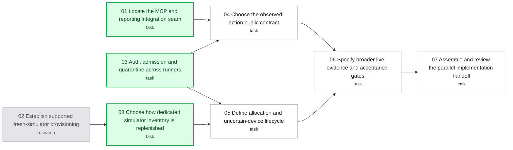

# Map: observed actions from live experiment to agent workflow

Label: wayfinder:map
Created: 2026-10-08

## Destination

An implementation-ready plan for exposing the validated observed-action runner through the agent interface, assigning fresh dedicated simulators, and validating broader unmodified-app flows. The handoff names bounded work packages, dependencies, suitable skills, acceptance evidence, and integration ownership.

## Notes

- Planning only: do not implement product code, operate simulators, merge, or publish in this effort. Task tickets may produce design, contract, and handoff documents to reach this destination; this is an explicit extension of wayfinder's prerequisite-only task convention.
- Owner's standing direction: autonomous parallel agents; keep apps unmodified; verify visible outcomes; report uncertainty honestly. Technical choices may be recommended and resolved within those constraints without a simulated human interview. New product scope or weaker guarantees require an actual owner decision.
- Baseline: `2ae75e5` on `feat/native-callback-diagnostic`; [prior map](../observed-ui/map.md), [live report](../observed-ui/live/report.md), [965-test verification](../observed-ui/integration/verification.md). These are inherited facts, not decisions resolved by this new map.
- Work in the existing isolated worktree. Main checkout has unrelated changes. One writer per ticket; coordinator alone edits this map, shared specifications, and dependency edges.
- All child tickets use `wayfinder:task` or `wayfinder:research`; `Mode: AFK` means delegated technical work, not a human conversation. Never resolve a HITL question by impersonating the owner.
- Consult `docs/agents/issue-tracker.md`, `docs/agents/domain.md`, ADR-0002, ADR-0005, and ADR-0007. Preserve frozen script/verdict/report meanings; an observed outcome is not a Jev pass or a native receipt.
- Dispatch and proposed implementation waves: [agent plan](agent-plan.md).
- Three child agents maximum at once. Parallel planning reads are allowed. Implementation later uses disjoint worktrees and commits; root integrates in dependency order and runs shared checks.
- Live execution belongs to the user-selected Orca pane `b0e5a4b6-106b-4dab-a49a-b3933445d4ef:1b178e31-086e-40c9-b4e2-b9a3dd45ad90`. Only one device operator at a time. Root watches and fixes integration. No live work is dispatched while charting.
- Preserve all existing quarantines and device claims; do not use the three retained live-test devices or the historical study device. Never read, copy, or print `.env` values.
- Skills: `wayfinder` for route changes; `grilling` and `domain-modeling` for scope and language; ticket-specific skills below. Independent `code-review` and `do-test` agents gate the eventual handoff and implementation.

## Decisions so far

- [Establish supported fresh-simulator provisioning](issues/02-simulator-provisioning.md): the pin supports existing-device boot/install but not creation; the inventory-source decision is now explicit.

## Route

<!-- route:start -->

<!-- route:end -->

## Not yet specified

- Exact implementation filenames, package sizes, and schema/tool names until compatibility and admission audits are available.
- The cheapest useful additional app/runtime matrix until provisioning capabilities and candidate artifacts are known.
- Release packaging and migration details until the public contract is selected. A release number is not chosen here.

## Out of scope

- Implementing, merging, publishing, or live-running the feature during charting.
- Native ownership, settlement, or contact-consumption/release certification; the 23 older tickets remain separate.
- Automatic replay, clearing uncertain claims by age/PID, modifying target apps for instrumentation, or new device transports without a separately justified decision.
- Physical devices, Android observed actions, broad gestures/typing, and general autonomous navigation in the first integration.
