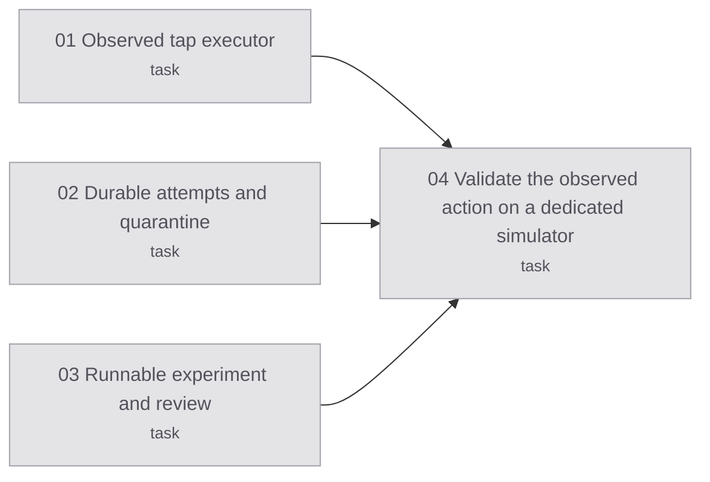

# Map: experimental observed iOS actions

## Destination

A runnable local alternative for unmodified apps: one action attempt, visible
outcome verification, persistent uncertainty and no automatic replay.

## Notes

The user chose this narrower contract on 2026-10-07 after confirming that the
native-provider route was unavailable. See [spec](spec.md) and [plan](plan.md).

## Decisions so far

- 2026-10-08: all three live cases passed after the experimental touch-path fix.
  [Live report](live/report.md); [integration verification](integration/verification.md).

- Use the existing MobileBuildMCP driver with an explicit no-retry tap path.
- Keep uncertainty in a durable journal; do not claim native contact release.
- Leave legacy script formats and the 23 native-certification tickets unchanged.

## Route

<!-- route:start -->

<!-- route:end -->

## Not yet specified

Production schema integration and automatic provisioning of fresh dedicated devices.

## Out of scope

Native ownership/contact certificates and automatic replay after uncertainty.
