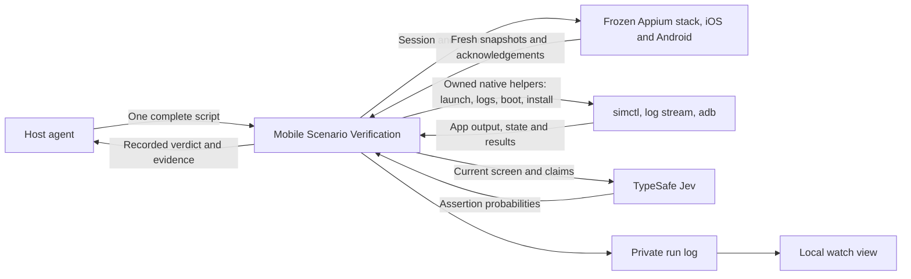

# jev-ios-bridge architecture

The bridge executes an authored script and asks Jev only to judge assertions. The assertion, real-execution, and installed-host gates passed; hardening, measurements and code review are complete, with the documented experimental limits. [ADR-0003](adr/0003-explicit-scripts-with-jev-assertions.md) records the change after three autonomous-action experiments failed.

## Context and authority

The run policy owns the verdict. Jev supplies probabilities; the device layer supplies captures and action results. The report and watch view present the recorded result. [Domain boundaries](domain-boundaries.md) keeps these responsibilities inside one context.

## One run

1. Validate the complete script, limits and credentials. Allocate a run log and acquire the device through the admission store.
2. Restart the installed app through the frozen Appium stack. The simulator or Android device is already booted; persistent data is a setup precondition. On iOS the bridge launches the app itself with `simctl launch --console-pty`, because Appium's launch gives no app output. On Android, preparation first checks the device (API level, boot, the app installed), reads the lock-screen state, refuses foreign automation, opens a session whose UiAutomator2 server APKs come from the frozen stack, and restarts the app with `mobile: startActivity`.
3. Capture the current screen before each step. Each capture settles on two matching reads, or after 3 seconds uses the last one and marks the screen still changing. Check distinguishing guards and resolve exactly one eligible target for an action. A missing, ambiguous, or unexpected state stops inconclusively.
4. Execute authored tap, text replacement or swipe actions, or poll a bounded wait. Use current references and require terminal acknowledgements. Fresh references never justify guessing after a changed screen.
5. At a checkpoint, project the current full accessibility capture and ask one Noul per claim. There is no Choice, completion question, future script, or value dictionary in the request.
6. Record the checkpoint result. Any confidently false claim (probability at or below 0.1) fails it, even beside uncertain claims ([ADR-0004](adr/0004-fixed-assertion-bounds-single-judgment.md)); otherwise any uncertain claim yields inconclusive. Passing requires all steps and checkpoints, followed by successful cleanup.
7. Stop the app, release the device lease, and append the final verdict. When the lease is released, nothing the run started can still act on the device. Until that can be shown (an unknown device outcome, a cleanup failure), the run keeps the lease, which prevents a pass, and releases it late once it can.

The script has finite steps and global time/step budgets. It does not escalate to the host or resume an interrupted run. The host polls progress with bounded waits; running responses contain no screen evidence for selecting another action.

## Modules

| Module | Responsibility |
| --- | --- |
| `src/scripted/schema` | Strict scenario, guard, selector, value and step validation |
| `src/scripted/select` | Unique eligible target resolution and guard checks |
| `src/scripted/run` | Ordered execution, limits, checkpoint policy and cleanup |
| `src/scripted/observe`, `jev` | Frozen assertion projection, pinned SDK request and response validation |
| `src/device` | The driver factory, the compatibility marker (`lease.ts`), the admission store and its upgrades, device identity resolution, and the settle rule, screenshots and log tails both platforms share |
| `src/appium` | The frozen stack's check and extraction (`stack.ts`), the private MCP client and session profiles, the versioned extension, observation, operations, the native helpers, and the fencing runner |
| `src/device/android` | The `adb` runner, logcat streams, the exit watch, the settle rule, the identity probe, and the element mapping Appium observation reuses, with the pre-Appium driver kept for replay |
| `src/capture.ts` | The Android `capture` command: one settled screen under admission, without launching the app |
| `src/logpane` | The live log pane and `logs`, following the app's own output on either platform |
| `src/log`, `src/scripted/report`, `src/watch` | Private evidence, report reconstruction and human viewing |
| `src/service`, `src/mcp`, `src/cli` | Job lifetime and public entrypoints |

Historical autonomous modules and experiments are retained for evidence and replay. The supported service/CLI/MCP path accepts scripts only.

## Device admission, the marker file, and fencing

The admission store is the authority for a device. It is one SQLite database per OS account, at `~/Library/Application Support/jev-ios-bridge/admission`, and every entry point opens it: a run, `capture`, and each observed command. A run takes an attempt for the device identity (a simulator's UDID, an emulator's AVD name, or a phone's serial), records what it issues, and closes its dispatch only once nothing it started can still act. That stop evidence is per component: an Appium session, a WebDriverAgent runner, a UiAutomator2 server, an `adb forward`, a `logcat` stream, a host stream, or a native helper process. Until the store holds it, the device stays quarantined and the run cannot pass. A crashed run's attempt passes to the next run, which fences only the bridge's own leftovers.

`src/device/lease.ts` writes a compatibility marker file per device, so an older bridge binary sees a device as busy. The marker is not the authority. A run that finds one checks the store for the recorded owner and, for an unknown marker, asks for a legacy import. Only the store releases a device. [ADR-0008](adr/0008-durable-ios-admission.md) and [ADR-0011](adr/0011-shared-admission-and-evidenced-native-fencing.md) record the design.

Any automation on the device that the store does not own is foreign: a WebDriverAgent runner, a UiAutomator2 server or instrumentation, or an automation `adb forward`. The run refuses with `DEVICE_BUSY` before any effect, and the bridge never stops it. On Android, the bridge installs only the frozen stack's UiAutomator2 server and test APKs, checked against their pinned SHA-256.

## Identity and evidence

Selectors use durable descriptions rather than captured element refs. Generic matching is conservative. One bridge-owned rule, `same-frame-buttons-v1`, collapses unidentified buttons that share one frame into a single target, so an exact-frame button alias resolves once. It never applies to different positions, and never to any action other than tap.

TypeSafe receives visible screen text and current claims. Supplied values go to device actions and may subsequently appear in that text. Screenshots remain local. The journal redacts supplied values and the API key; image contents are not text-redacted. The watch view binds to localhost and requires its access token.

The run log stores decisive assertion observations and copied screenshots. Reports include claims, probabilities, semantic screen evidence and local pointers. Their text is bounded and marks truncation; complete local evidence remains available. An incomplete final JSONL record can be recovered, but an absent final verdict remains inconclusive.

## Validated limits

- macOS on Apple silicon with Node 24 or later, the frozen Appium stack (`appium-mcp` 1.97.0, WebDriverAgent 16.14.2, the UiAutomator2 server APKs by SHA-256), Jev 1.13.0 and SDK 0.6.0.
- iOS simulators on iOS 26.5 with Xcode 27.0, and Android 12 (API 31) or later on emulators and (untested) phones; another iOS or Xcode version warns and continues, and build/install/seed/reset are outside the bridge.
- At most 100 authored steps; default whole-run time 300 seconds, configurable up to one hour. Each wait is at most 60 seconds.
- Fixed Noul yes/no bounds 0.9/0.1. Uncertainty is visible and never promoted to a pass.
- Full observation cap 24,000 bytes; state plus longest question 28,000 bytes; total request 56,000 bytes. Overflow stops rather than silently removing evidence.
- On both platforms, any text except control characters, a leading hyphen included. Typed values never reach the device clipboard.

See the [guide](guide/README.md) for setup and use, and the v0.1.0 [tracker](../.scratch/jev-ios-bridge/map.md) and [release plan](../.scratch/jev-ios-bridge/release-plan.md) for that release's evidence and verification. The v1.0.0 plan is the [release spec](../.scratch/v1-release/release-spec.md), and the v1.2.0 Android plan is its [own release spec](../.scratch/android-support/release-spec.md), with the [domain model](../.scratch/android-support/domain-model.md).
